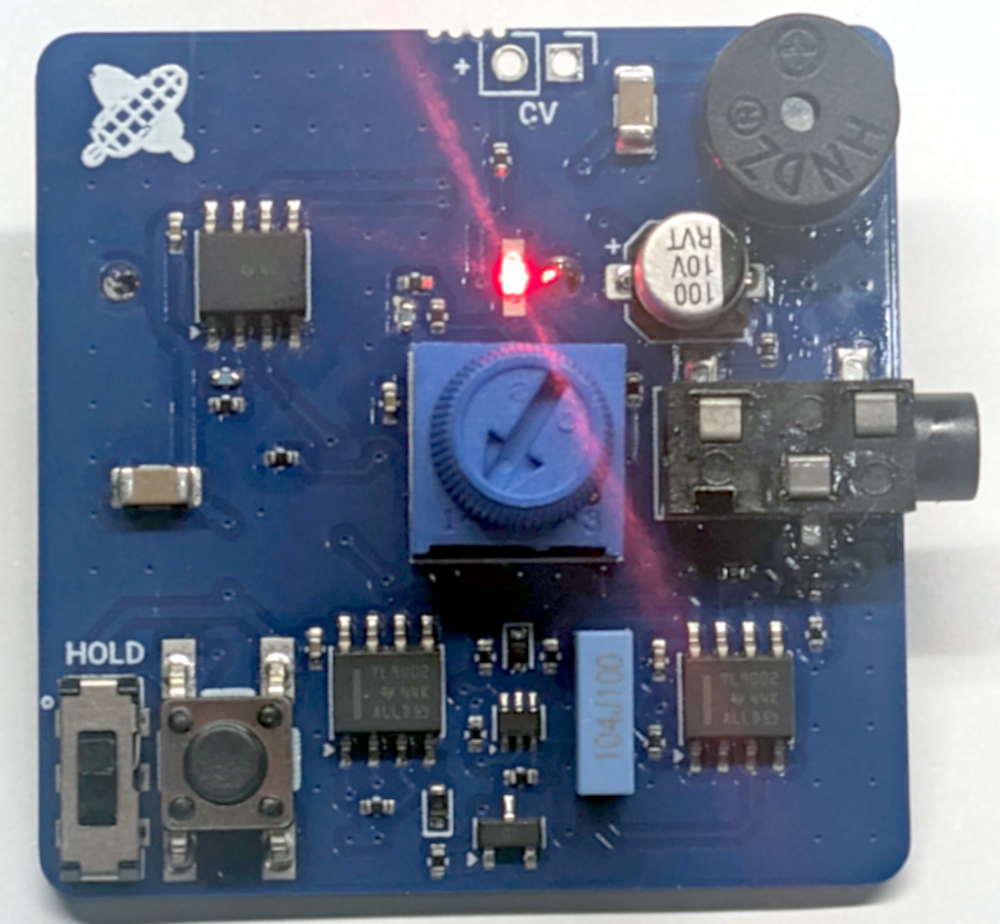
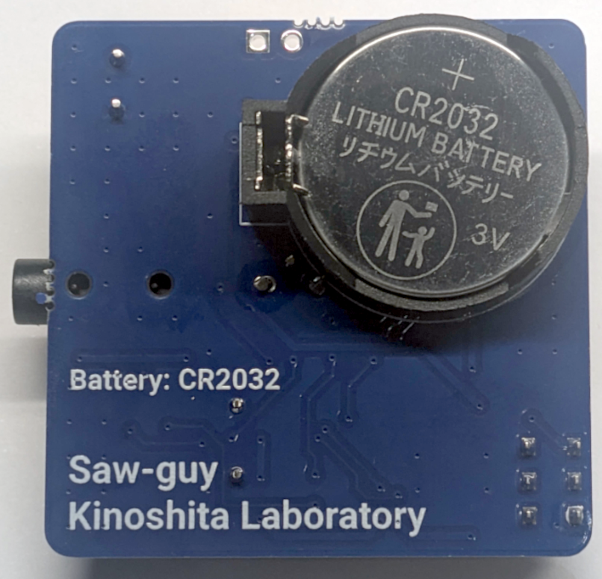
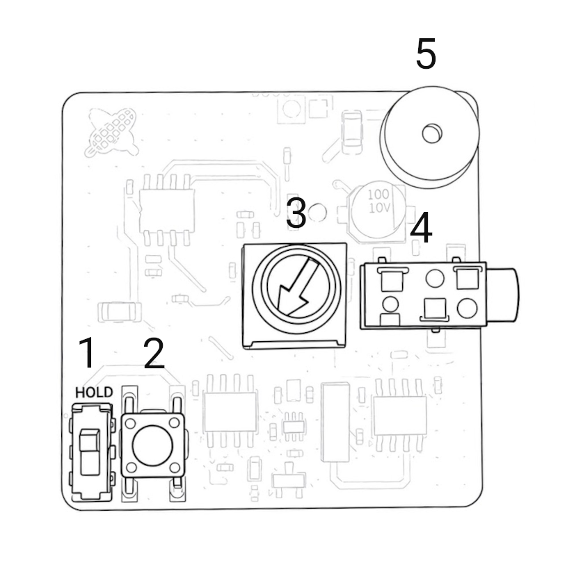

# Saw Guy

A tiny analog sawtooth VCO on a 40 × 40 mm board, powered by a CR2032 coin cell.
Press the button and it plays: a raw sawtooth from the on-board speaker and the
3.5 mm jack, with an LED that follows the waveform.

| Top | Bottom |
| --- | --- |
|  |  |

Demo video: [images/movie.mp4](images/movie.mp4)

## Features

- Analog sawtooth oscillator with an exponential (transistor-pair) pitch converter
- Single pitch knob, sweeping from slow sub-audio ticks (the LED visibly blinks) up into the audio range
- External CV input (2-pin header) summed into the pitch control
- On-board speaker and 3.5 mm audio output, both active at the same time
- Red LED whose brightness follows the sawtooth
- Momentary **play** button plus a **HOLD** switch for continuous sound
- Runs on a single CR2032 (3 V); the battery is only connected while the button is pressed or HOLD is on, so there is no standby drain

## Controls

| # | Part | Function |
| --- | --- | --- |
| 1 | HOLD switch (SW1) | Plays continuously |
| 2 | Push button (SW2) | Plays while pressed |
| 3 | Knob (RV1) | Pitch |
| 4 | 3.5 mm jack (J2) | Audio output (mono, on the tip) |
| 5 | Speaker (LS1) | Built-in speaker |

On the top edge there is a 2-pin **CV** header (J3, marked `+`). A positive
voltage on `+` raises the pitch. The input goes through 100 kΩ into the knob's
wiper, so it adds to the knob position. The response is exponential, but it is
not calibrated to 1 V/oct and also has no temperature compensation.

